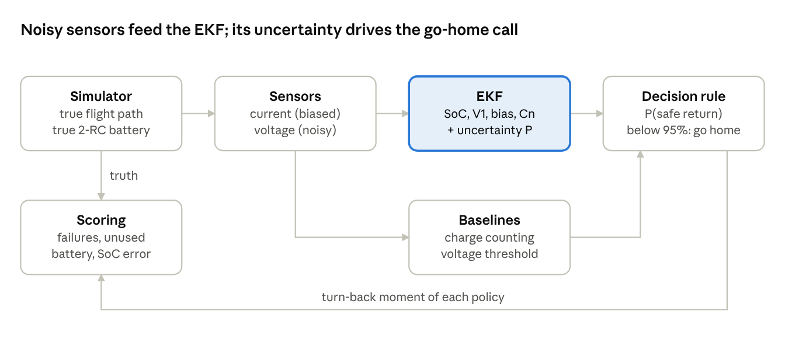

# Battery-Aware Return-to-Home for a Delivery Drone - EKF Implementation

A delivery drone must decide when to stop delivering and fly home, but nobody can measure how much charge is left. This project uses an **Extended Kalman Filter (EKF)** to estimate the battery's state of charge (SoC) **and how uncertain that estimate is**. A **risk-aware rule** then uses both to turn back when the drone is no longer 95% sure of landing with a 10% reserve.

Everything runs in simulation (MATLAB), so the true SoC is always known and every estimate and decision can be scored.



## Key results

**500 random missions** with random start charge, current-sensor bias, wind, battery age (80–100% capacity) and battery parameters. The long route is too far for one battery, so the drone must decide when to turn back.

| Return-to-home policy | Battery died | Reserve broken* | Unused battery | Deliveries |
|---|---|---|---|---|
| A: voltage threshold (3.5 V) | 9.2% | 32.2% | 8.0% | 0.85 |
| B: charge counting + margin | 30.4% | 90.2% | −4.1% | 1.56 |
| C: EKF estimate + margin | 0.0% | 38.0% | 0.6% | 1.32 |
| **D: EKF risk-aware, P(safe) < 95%** | **0.0%** | **2.8%** | 6.1% | 1.16 |

\* landed below the 10% reserve, or died.

- **D never ran out of battery and broke the reserve in only 2.8% of missions**, within its 5% promise. It stays within its promise at every threshold tested (80% to 99.9%), so the filter's uncertainty is calibrated.
- C uses the **same filter** as D but ignores its uncertainty. It aims exactly at the reserve and breaks it in 38% of missions.
- Charge counting (B) is optimistic with aged batteries: it died in 58% of missions whose battery had less than 90% capacity.
- No fixed voltage threshold (A) is both safe and efficient. Matching D's safety needs 3.55 V, which wastes about 3× more battery and completes about half the deliveries.
- Estimator accuracy over the 500 missions: **EKF RMSE 1.31%**, against 3.35% for charge counting. The truth was inside the EKF's ±3σ band 100% of the time.

## How the filter works

The battery is modelled as a 1-RC equivalent circuit. The EKF state is

```
x = [SoC, V1, b, Cn, R0]
     SoC: state of charge        V1: polarisation voltage
     b:   current-sensor bias    Cn: capacity    R0: ohmic resistance
```

The measured current drives the prediction. The measured terminal voltage, `V = OCV(SoC) − V1 − R0·(Im − b)`, drives the correction. Three filter stages were compared:

| Stage | Learns | Finding |
|---|---|---|
| A | SoC, V1 | Biased and overconfident when the real battery's resistance differs from the model |
| B | + R0 | Most accurate on a healthy battery, but confidently optimistic on an aged one |
| C | + b, Cn | Consistent (honest ±3σ) in every normal scenario, so **stage C drives the decision** |

Bias and capacity cannot be separated within one flight. Their combination, the drain rate `(Im − b)/Cn`, is observable, so the trip-home cost uses that rate.

The simulator's "real" battery is deliberately different from the filter's model: a 2-RC circuit, different parameters and a shifted OCV curve. This makes the results honest.

## Repository structure

```
drone_battery_ekf/
├── main_day2_simulator.m      Simulator check: one delivery flight, no filter
├── main_day3_ekf.m            E1 normal flight, E2 wrong start (stages A and B)
├── main_day4_experiments.m    E3 bias, E4 aged battery, E5 tuning, E6 stress test,
│                              E7 flat OCV region, E8 20-flight comparison
├── main_day5_rth.m            Return-to-home: demo, 500-mission Monte Carlo, threshold sweep
├── learning/
│   └── day1_ekf_by_hand.m     One EKF step worked by hand (learning exercise)
├── config/
│   ├── battery_params.m       Truth, filter and sensor parameters
│   ├── ocv_lookup.m           OCV curve and its slope
│   └── soc_from_ocv.m         Resting voltage -> starting SoC
├── sim/
│   ├── make_mission.m         'short' and 'long' delivery routes
│   ├── drone_init.m, drone_step.m           Drone flight phases
│   ├── battery_true_init.m, battery_true_step.m   The "real" 2-RC battery
│   ├── read_sensors.m         Biased, noisy current and voltage sensors
│   ├── run_flight.m           One flight with EKF + charge counting (experiments)
│   ├── run_mission_rth.m      One long mission where a policy decides when to return
│   ├── draw_conditions.m      Random conditions for the Monte Carlo study
│   └── flight_metrics.m       RMSE, ±3σ coverage, NIS, NEES
├── estimators/
│   ├── ekf_init.m             Starting guess, uncertainty, tuning, stage A/B/C
│   ├── ekf_step.m             One predict + update
│   └── coulomb_count.m        Charge-counting baseline
├── decision/
│   ├── trip_soc.m             Charge needed to fly home and land
│   ├── p_safe_return.m        P(home with reserve) = Phi(margin / sigma)
│   └── rth_policy.m           Policies A-D
└── results/                   Figures, .mat and .csv files written by the scripts
Report/                        LaTeX report (main.tex, chapters/, figures/)
Report/notes/plain_summary.md  Plain-language summary of every chapter, with likely examiner questions
docs/project_guide.md          The original project plan and theory primer
```

`docs/project_guide.md` describes the plan as it stood at the start. The final design differs in two places: R0 was added as a state, and stage C drives the decision. The report describes the final design.

## Requirements

- MATLAB R2019b or later. Only base MATLAB is used; no toolboxes are required.
- R2020a or later is recommended, so figures are saved with `exportgraphics` (older versions fall back to `saveas`).

## How to run

Open MATLAB in the `drone_battery_ekf` folder and run the scripts in order. Each one adds the folders it needs to the path and writes its outputs to `results/<day>/`.

| Script | What it produces | Run time |
|---|---|---|
| `learning/day1_ekf_by_hand.m` | One EKF step printed number by number, and a 10-minute discharge plot | seconds |
| `main_day2_simulator.m` | Simulator check: mission map, current, voltage sag, true SoC | seconds |
| `main_day3_ekf.m` | E1/E2 tables and figures (stage A vs B vs charge counting) | seconds |
| `main_day4_experiments.m` | E3–E8 tables, 6 figures, `e8_summary.csv` | about 30 s |
| `main_day5_rth.m` | Demo, Monte Carlo and threshold sweep: 4 figures, 2 CSV files | about 4–5 min |

For a quick check of `main_day5_rth.m`, set `N_MC = 50` and `N_SWEEP = 30` at the top of the script.

All random numbers are seeded, so every run reproduces the same results.

## Limitations

- Simulation only. The OCV curve is a representative Li-ion curve rather than measured data, and temperature and hysteresis are not modelled.
- Under a strong model mismatch (experiment E6) no filter stays consistent. The EKF is only as good as its model.
- Bias and capacity are only weakly observable within one flight. Estimating capacity between flights, and calibrating the bias at rest, would improve this.
- The return-to-home rule assumes Gaussian errors, a straight flight home and a constant cruise current.

## Author

B.M.N.S. Basnayake (220072R), Department of Electronic and Telecommunication Engineering, University of Moratuwa. Mini-project: *Implementing State Estimation Filters*, 2026.
